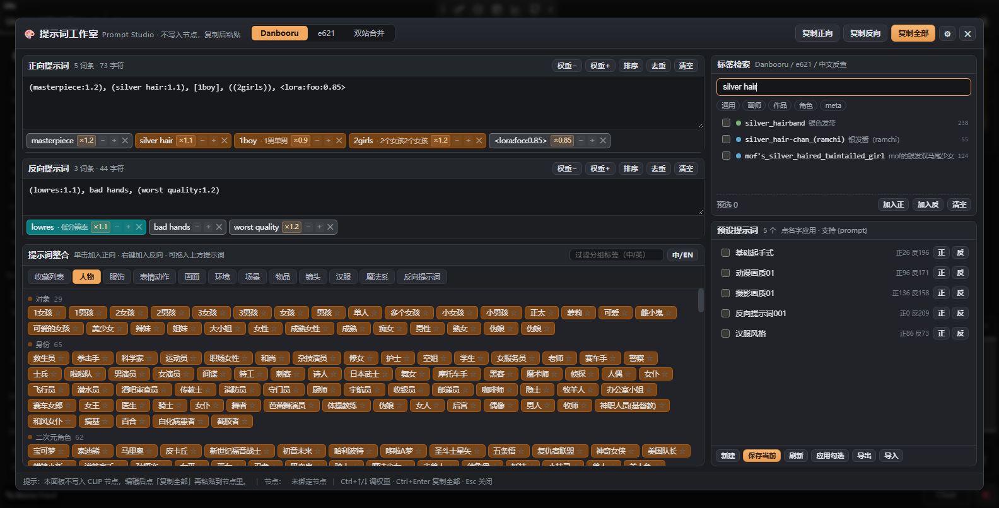
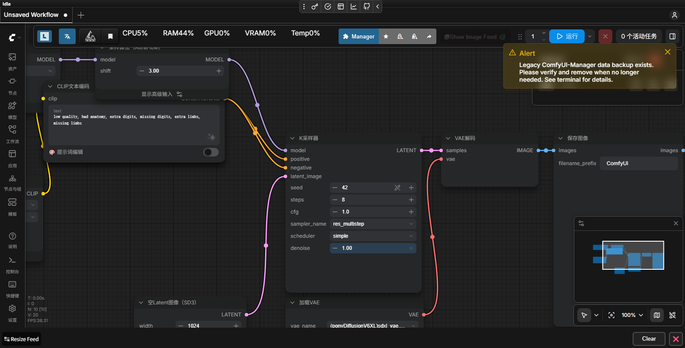

# ComfyUI Prompt Studio · 提示词工作室

把 WebUI 提示词页面那一套搬进 ComfyUI：正负提示词双栏、Danbooru / e621 标签检索、彩色标签分组、可拖动排序、右侧预设提示词。
**面板只做编辑，不写节点、不参与采样、不注入提示词**——编辑完点「复制全部」，自己粘贴到 CLIP 文本节点里。





## 功能

- **正 / 负提示词双栏**：逗号切分成彩色标签，`×` 删除，拖动换位，也可以从一个框拖到另一个框。
- **WebUI 同款权重编辑**：选中文字或光标停在标签上，`Ctrl+↑ / Ctrl+↓` 调权重；标签上有 `− / +` 按钮和 `×1.2` 徽标，工具栏也有「权重− / 权重+」。
- **三个检索页签**：`Danbooru` / `e621` / `双站合并`，分类过滤（通用 / 画师 / 作品 / 角色 / meta / 物种），支持中文反查与别名匹配。
- **提示词预选**：检索结果勾选进「预选架」，再批量加入正向 / 反向。
- **提示词整合**：收藏列表 + 人物 / 服饰 / 表情动作 / 画面 / 环境 / 场景 / 物品 / 镜头 / 汉服 / 魔法系 / 反向提示词，3981 个带中文翻译的标签。
- **预设提示词**：保存 / 应用 / 编辑 / 复制 / 删除 / 导入导出，支持 `{prompt}` 占位符。
- **CLIP 节点开关**：`CLIPTextEncode`、`CLIPTextEncodeSDXL`、`CLIPTextEncodeFlux`、`BNK_CLIPTextEncodeAdvanced` 等节点底部多一个 `🎨 提示词编辑` 开关，点开面板；右键节点、`Ctrl+Shift+P`、`promptStudio.open()` 也能打开。
- **不碰数据**：开关 `serialize: false`，不写 widget、不参与采样；工作流序列化里只有原来的 `text`。

## 安装

### ComfyUI Manager

1. Manager → **Custom Nodes Manager**。
2. 搜索 `Prompt Studio Editor`（或节点 ID `prompt-studio-editor`）。
3. Install → 重启 ComfyUI。

### 手动

```bash
cd ComfyUI/custom_nodes
git clone https://github.com/mengxinxiaoyingxiong/ComfyUI-PromptStudio.git
```

重启 ComfyUI（刷新浏览器不够，后端路由要重新注册）。启动日志出现 `[PromptStudio] 路由已注册 /prompt_studio/*` 即成功。

### 词库

插件自带**一键下载**：面板右上角 ⚙ → 「下载词库」，从 [a1111-sd-webui-tagcomplete](https://github.com/DominikDoom/a1111-sd-webui-tagcomplete)（MIT）拉取 `danbooru.csv` / `e621.csv` 到 `data/tags/`。两个文件并行下载，约 6MB；网络慢时可能要 1–2 分钟，失败可直接重试。

也可以复用本机已有词库——首次运行会在 `data/tags_config.json` 里生成探测列表，自动找：

- `ComfyUI-PromptStudio/data/tags/`
- `ComfyUI/web/extensions/a1111-sd-webui-tagcomplete/tags/`
- `ComfyUI/custom_nodes/a1111-sd-webui-tagcomplete/tags/`
- 与 ComfyUI 同级的 WebUI / Forge 整合包（向上找 3 层，扫描同级目录）
- `~/sd-webui/extensions/a1111-sd-webui-tagcomplete/tags/`
- 环境变量 `PROMPT_STUDIO_TAG_DIR`

需要的文件：`danbooru.csv`、`e621.csv`、`danbooru.zh_CN_SFW.csv`（中文反查，可选）、`danbooru_e621_merged.csv`（可选）。CSV 编码自动识别（UTF-8 / UTF-8 带坏字节 / GB18030 / Shift-JIS）。

## 界面

| 区域 | 作用 |
| --- | --- |
| 顶部三个页签 | `Danbooru` / `e621` / `双站合并`，检索只查当前页签的词库 |
| 正向 / 反向提示词 | 文本框 + 彩色标签条；`✕` 删除，拖动标签可换位、可拖到另一个框 |
| 每个提示词框右上 | `权重−` / `权重+`、排序（按词频）、去重、清空；正向框还有「读取节点」（只读，不写回） |
| 标签检索（右侧） | 输入即搜，支持英文标签、别名、中文反查；↑↓ 选择、Enter 加正向、Shift+Enter 加反向 |
| 分类过滤 | 通用 / 画师 / 作品 / 角色 / meta（e621 另有物种），可多选 |
| 预选区 | 每行左侧复选框把标签放进「预选」，再一批「加入正 / 加入反」 |
| 提示词整合（下方） | 收藏列表 + 各分组；单击加正向、右键加反向、拖进提示词框、点 ☆ 收藏 |
| 预设提示词（右下） | 新建 / 保存当前 / 刷新 / 应用勾选 / 导出 / 导入；点预设名应用到正向，「正 / 反」分别应用，悬停出现 ✎ 编辑、⧉ 复制、🗑 删除 |

快捷键：`Esc` 关闭（先关子弹窗）、`Ctrl+Enter` 复制全部、`Ctrl+↑/↓` 调权重、`Ctrl+Shift+P` 开关面板。

## 权重编辑（WebUI 风格）

行为对齐 A1111 的 `javascript/edit-attention.js`（独立实现）：

- 选中文字后 `Ctrl+↑`：`tag` → `(tag:1.1)`，再按 → `(tag:1.2)`；`Ctrl+↓` 到 1.0 时会自动去掉括号还原成 `tag`。
- 没有选中时：光标在 `()` / `[]` / `<>` 里就调这一层；否则自动选中光标所在的逗号段。
- 老式写法：`((tag))` 会折算成 `(tag:1.2)` 再 ±0.1；`[tag]` 按 0.9 折算，加回 1.0 时自动还原。
- `<lora:name:0.8>`：按 0.05 步长调 LoRA 权重（`Ctrl+↑` → 0.85）。
- 标签条上的 `−` / `+` 一次 ±0.1，`×1.2` 是当前权重徽标；`(masterpiece, best quality:1.2)` 这种带逗号的括号组会当成一个标签整体处理。
- 反向提示词同样支持，工具栏的「权重− / 权重+」对选中文字或光标所在标签生效。

## 预设与 `{prompt}`

- 预设保存 `prompt`（正向）与 `negative`（反向）两段文本。
- 应用时若含 `{prompt}`，用当前提示词替换；不含则追加到末尾。

  ```
  预设：masterpiece, best quality, {prompt}
  当前正向：1girl, silver hair
  应用后：masterpiece, best quality, 1girl, silver hair
  ```

- 存放位置：`ComfyUI/user/default/prompt_studio/presets.json`，收藏在 `favorites.json`。
- 「导出」写出 `prompt_studio_presets.json`；「导入」按名字合并，同名跳过。

## 中文检索

- 输入中文会同时查 `danbooru.zh_CN_SFW.csv` 与英文标签，结果里 `CN` 徽标表示来自中文表。
- 英文检索同时匹配标签名与别名（例如 `tits` 能搜到 `breasts`），完全命中 / 前缀 / 包含的优先级依次降低，再按词频排序。
- 查询里的空格会自动当成下划线，`silver hair` 等价于 `silver_hair`。

## HTTP 接口

| 方法 | 路径 | 说明 |
| --- | --- | --- |
| GET | `/prompt_studio/status` | 词库路径、条数、状态目录 |
| GET | `/prompt_studio/tags?q=&source=danbooru&#124;e621&#124;both&cats=0,4&limit=80` | 标签检索 |
| GET | `/prompt_studio/lookup?names=a,b,c` | 批量查分类 / 词频 / 中文 |
| GET/POST | `/prompt_studio/groups` | 读取 / 覆盖分组词库（POST 写入 user 目录） |
| POST | `/prompt_studio/groups/reset` | 恢复默认分组 |
| GET/POST | `/prompt_studio/presets` | 读取 / 保存预设（整份覆盖） |
| GET/POST | `/prompt_studio/favorites` | 读取 / 保存收藏 |
| POST | `/prompt_studio/download_tags` | 下载 danbooru / e621 词库 |

## 自定义分组

- 临时改：面板里点 ☆ 收藏，收藏列表就是你的自定义分组。
- 大改：`POST /prompt_studio/groups` 传
  `{ "groups": [ { "name": "人物", "groups": [ { "name": "对象", "color": "rgba(255,123,2,.4)", "tags": [["1girl","1女孩"]] } ] } ] }`，
  写入 `user/default/prompt_studio/groups.json`；删掉该文件恢复 `data/groups_zh.json`。

## 目录结构

```
ComfyUI/custom_nodes/ComfyUI-PromptStudio/
├─ __init__.py                 注册 WEB_DIRECTORY 与后端路由
├─ prompt_studio_server.py     检索 / 预设 / 收藏 / 分组 / 词库下载
├─ pyproject.toml              Registry 元数据（发布用）
├─ LICENSE                     MIT
├─ .comfyignore                不打进 Registry 安装包的文件
├─ data/
│  ├─ groups_zh.json           分组词库（3981 条，来自 sd-webui-prompt-all-in-one，MIT）
│  ├─ presets.default.json     初始预设
│  └─ tags/                    可选的本地 CSV（git 忽略）
├─ docs/                       预览图 / 图标 / 横幅
├─ .github/workflows/          自动发布 Action
└─ web/
   ├─ prompt_studio.js         悬浮面板 + CLIP 节点开关
   └─ prompt_studio.css        面板样式
```

## 发布与更新（维护者）

- 节点 ID：`prompt-studio-editor`（Registry 唯一，发布后不可改）
- Publisher：`mengxinxiaoyingxiong`
- 发布页：<https://registry.comfy.org/mengxinxiaoyingxiong/prompt-studio-editor>

发布走 GitHub Actions：

1. 按语义化版本修改 `pyproject.toml` 的 `version`（1.0.1 / 1.1.0 / 2.0.0）。
2. push 到 `main`，或手动 Actions → **Publish to Comfy registry** → Run workflow。
3. `.github/workflows/publish_action.yml` 用仓库 Secret `REGISTRY_ACCESS_TOKEN` 执行 `comfy node publish`。

本机发布备选：

```bash
pip install comfy-cli
cd ComfyUI/custom_nodes/ComfyUI-PromptStudio
comfy node publish
```

Manager 验证：重启 ComfyUI → Custom Nodes Manager → 搜索 `Prompt Studio Editor`；Registry 索引有几分钟延迟。旧版 Manager（v2）可以再给 [ComfyUI-Manager](https://github.com/ltdrdata/ComfyUI-Manager) 提 `custom-node-list.json` PR。

### 发布检查表

- [ ] `git ls-files` 里没有本机配置、CSV、`__pycache__`、日志
- [ ] `pyproject.toml` 的 PublisherId / URL / Icon 是真实值
- [ ] `LICENSE`、`README.md`、`docs/icon.png`（≤400×400）都在
- [ ] `python -m py_compile prompt_studio_server.py __init__.py` 通过
- [ ] 重启后 `[PromptStudio] 路由已注册`，节点开关可用
- [ ] `docs/` 与 `.github/` 已写进 `.comfyignore`，不打进安装包

## 排错

| 现象 | 处理 |
| --- | --- |
| 节点上没有开关 | 该节点类型不在匹配规则内 → 右键菜单 / `Ctrl+Shift+P` / `promptStudio.open()` |
| 面板打不开、控制台 404 | 没重启后端，或 `WEB_DIRECTORY` 没加载；看启动日志有没有 `[PromptStudio] 路由已注册` |
| 检索一直空 | ⚙ 看词库路径，点「下载词库」；或改 `tags_config.json` 后重启 |
| 中文搜不到 | 缺 `danbooru.zh_CN_SFW.csv`，或该标签不在中文对照表里 |
| 下载词库失败 | 检查能否访问 raw.githubusercontent.com；也可以手动把 CSV 放进 `data/tags/` |
| 启动报 `未找到 PromptServer` | 只在独立测试时出现，ComfyUI 内不会 |

## 调试

- 地址栏加 `?ps=1` 打开 ComfyUI 时会自动弹出面板。
- 控制台 `promptStudio.open()` / `promptStudio.close()` / `promptStudio.state`。
- `Ctrl+Shift+P` 全局开关面板。

## 致谢与许可

- 代码：MIT，见 [LICENSE](LICENSE)。
- 权重编辑：行为对齐 [AUTOMATIC1111/stable-diffusion-webui](https://github.com/AUTOMATIC1111/stable-diffusion-webui) 的 `edit-attention`（独立实现，未复制其代码；该项目为 AGPL-3.0）。
- 标签数据：[a1111-sd-webui-tagcomplete](https://github.com/DominikDoom/a1111-sd-webui-tagcomplete)（MIT）。
- 分组与中文标签：[sd-webui-prompt-all-in-one](https://github.com/Physton/sd-webui-prompt-all-in-one) 的 `zh_CN.yaml`（MIT），已转换为 `data/groups_zh.json`。
- 中文对照表来自社区整理的 `danbooru.zh_CN_SFW.csv`，不随仓库分发。
